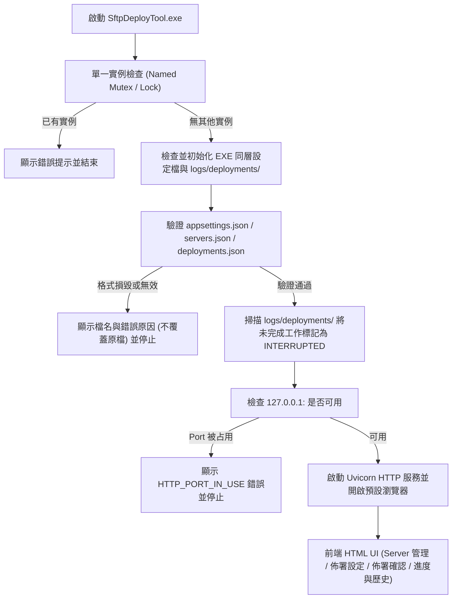

# Windows 本機 SFTP 檔案上傳工具 (SftpDeployTool) 實作計畫

## 1. 目標說明

依據 [Windows 本機 SFTP 檔案上傳工具 SPEC.md](./Windows%20%E6%9C%AC%E6%A9%9F%20SFTP%20%E6%AA%94%E6%A1%88%E4%B8%8A%E5%82%B3%E5%B7%A5%E5%85%B7%20SPEC.md)，開發一套可在 **無安裝 Python / Node.js 等任何 Runtime 的乾淨內網 Windows 10 x64 環境** 直接執行的本機 SFTP 檔案上傳工具（`SftpDeployTool.exe`）。

本計畫涵蓋：
1. **Python 後端服務**（FastAPI + Uvicorn + Paramiko）：提供設定檔管理、原子寫入、啟動復原、單一背景佈署工作管理、串流 SFTP 上傳與分頁歷史紀錄查詢。
2. **內嵌離線前端 UI**（原生 HTML5 + CSS3 + Vanilla JS）：不依賴任何外部 CDN 或前端編譯環境，由執行檔套件直接提供靜態資源。
3. **PyInstaller `--onedir` 獨立執行包打包**：產出 `SftpDeployTool.exe`（搭配 `_internal/` 內嵌執行環境與資源）及完整交付目錄（含初始範例 JSON 與操作說明文件），雙擊秒開且不依賴 `%TEMP%` 解壓縮。
4. **自動化驗收測試**：針對 SPEC 第 19 章的 `AC-01` ～ `AC-28` 撰寫自動化測試（含內建測試用 SFTP Server 模擬各種連線、權限、斷線與覆蓋情境）。

---

## 2. 系統架構與流程圖



---

## 3. 專案目錄與交付結構

```text
d:\workspace\SftpDeployTool\
├─ Windows 本機 SFTP 檔案上傳工具 SPEC.md
├─ IMPLEMENTATION_PLAN.md      # 本實作計畫文件
├─ README.md                   # 操作與限制風險說明文件
├─ requirements.txt
├─ main.py                     # 程式進入點（啟動檢查、Mutex、Uvicorn 啟動、開啟瀏覽器）
├─ build_release.py            # 自動化 PyInstaller --onedir 打包與建立交付目錄腳本
├─ app/
│  ├─ __init__.py
│  ├─ paths.py                 # 處理 EXE 同層目錄 (sys.executable) 與內嵌資源目錄 (sys._MEIPASS)
│  ├─ errors.py                # 定義第 16 章所有標準錯誤代碼與統一 JSON 例外格式
│  ├─ models.py                # Pydantic 資料模型與嚴格驗證規則 (Server, Profile, Job, Paging)
│  ├─ storage.py               # JSON 讀寫、UTF-8 檢查、寫入暫存檔替換原檔 (.tmp -> .bak -> .json)
│  ├─ sftp_client.py           # Paramiko SFTP 封裝（連線測試、父目錄與目標型態檢查、64KB 分塊串流與 60s 逾時）
│  ├─ job_manager.py           # 單一背景工作控制、設定快照、斷線重連一次策略、INTERRUPTED 啟動復原
│  ├─ api.py                   # FastAPI 路由實作 (第 15.2 章全部 API 與靜態資源掛載)
│  └─ static/
│     ├─ index.html            # 單頁應用程式介面 (Server 管理、佈署設定、確認彈窗、即時進度、歷史紀錄)
│     ├─ styles.css            # 內建現代化樣式表（無外部字型或 CDN 依賴）
│     └─ app.js                # 原生前端邏輯（表單驗證、順序調整、每秒輪詢、頁面重整恢復工作、安全退出）
├─ tests/
│  ├─ conftest.py              # 內建模擬 SFTP Server 與暫存目錄 Fixture
│  └─ test_acceptance.py       # 對應 AC-01 ~ AC-28 的完整驗收測試
└─ release/                    # 最終可直接交付至無 Python 環境的產出目錄
   └─ SftpDeployTool/
      ├─ SftpDeployTool.exe
      ├─ _internal/            # Python Runtime、相依套件與 static 前端資源
      ├─ appsettings.json
      ├─ servers.json
      ├─ deployments.json
      ├─ README.md             # 操作說明與限制風險說明 (對應第 20 章交付項目 5 & 6)
      └─ logs/
         └─ deployments/
```

---

## 4. 模組設計細節

### 4.1 核心基礎設施 (`app/paths.py`, `app/errors.py`, `app/models.py`, `app/storage.py`)
- **路徑解析 (`app/paths.py`)**：
  - `get_base_dir()`：在 PyInstaller 打包環境下回傳 `Path(sys.executable).resolve().parent`，確保設定檔與 `logs/deployments` 永遠位於 EXE 同層（符合 5.1 節）。
  - `get_static_dir()`：在 PyInstaller 打包環境下從 `Path(sys._MEIPASS) / "app" / "static"` 讀取前端資源。
- **錯誤處理 (`app/errors.py`)**：
  - 完整定義第 16 章全部 21 組錯誤代碼，並以統一的 `{"error": {"code": "...", "message": "...", "details": ...}}` JSON 格式回應，確保任何錯誤訊息皆不包含敏感密碼。
- **資料模型與驗證 (`app/models.py`)**：
  - 強制驗證 `schemaVersion == 1`。
  - `Server`：檢查 `name`、`host`（不含協定、Port、路徑）、`port`（預設 22，1–65535）、`username`、`password`（禁止空密碼、不自動去除前後空白、UTF-8 Base64 編解碼檢查）。
  - `DeploymentProfile`：`localPath` 須為 Windows 絕對檔案路徑且不以斜線結尾；`remotePath` 須以 `/` 開頭且不以 `/` 結尾，禁止 `/../`、`/./`、`\`、`//`；同一設定內禁止重複 `remotePath`。
- **原子寫入與備份 (`app/storage.py`)**：
  - 首次啟動僅在檔案不存在時建立預設檔；若檔案已存在但損毀或格式錯誤，拋出 `CONFIG_INVALID` 並保留原檔不覆蓋（AC-25）。
  - 保存時先寫入 `.tmp` 並 `fsync`，將舊檔備份為 `.bak` 後以 `os.replace` 替換目標檔。

### 4.2 SFTP 傳輸與背景工作管理 (`app/sftp_client.py`, `app/job_manager.py`)
- **SFTP 串流與逾時 (`app/sftp_client.py`)**：
  - 連線逾時 15 秒、認證逾時 30 秒、SFTP Channel 無進展逾時 60 秒。
  - 逐檔檢查本機檔案狀態、遠端父目錄存在性（不存在報 `REMOTE_DIRECTORY_NOT_FOUND`，不自動建立目錄）、遠端目標是否為資料夾（是資料夾報 `REMOTE_PATH_INVALID`）。
  - 以 64KB 區塊串流寫入覆蓋目標檔案，不將整個檔案載入記憶體。
- **背景工作引擎 (`app/job_manager.py`)**：
  - 單一工作鎖定（同時僅允許一個 `QUEUED`/`RUNNING` 工作，重複觸發回 `409 DEPLOYMENT_ALREADY_RUNNING`）。
  - 建立當下擷取設定快照（密碼不寫入紀錄檔）；初始紀錄寫入失敗時拒絕開始上傳（AC-26）。
  - 初始連線或認證失敗時，將所有未完成檔案直接標記失敗原因；上傳中途斷線時，當前檔案失敗，下一筆檔案嘗試重連一次，若重連亦失敗則將後續所有檔案標記為失敗（12.6 節）。
  - 執行期間若更新工作紀錄失敗，繼續完成檔案上傳並標記 `recordWriteFailed = True` 供前端顯示警告（AC-27）。
  - 啟動時掃描未結束之 `QUEUED`/`RUNNING` 工作，將整體與未完成檔案標記為 `INTERRUPTED`，`finishedAt` 保持 `null`（AC-23）。

### 4.3 API 與前端介面 (`app/api.py`, `app/static/*`, `main.py`)
- **FastAPI 路由 (`app/api.py`)**：實作 `/api/settings`、`/api/shutdown`、`/api/servers`、`/api/profiles`、`/api/deployments` 等全部端點。
- **原生前端 UI (`app/static/*`)**：
  - 包含「佈署執行與即時進度」、「佈署設定管理（含檔案順序上下移）」、「Server 設定管理（含連線測試与引用顯示）」、「歷史紀錄分頁與明細查詢」四大區塊，以及佈署前確認彈窗與安全退出功能。

---

## 5. 驗收測試與打包驗證計畫

1. **自動化驗收測試 (`pytest tests/test_acceptance.py -v`)**：涵蓋 SPEC 第 19 章 AC-01 ～ AC-28。
2. **PyInstaller `--onedir` 打包與實機測試 (`python build_release.py`)**：驗證產出之 `release/SftpDeployTool/SftpDeployTool.exe` 可獨立啟動、自動初始化設定、提供離線 UI 並正常退出。
